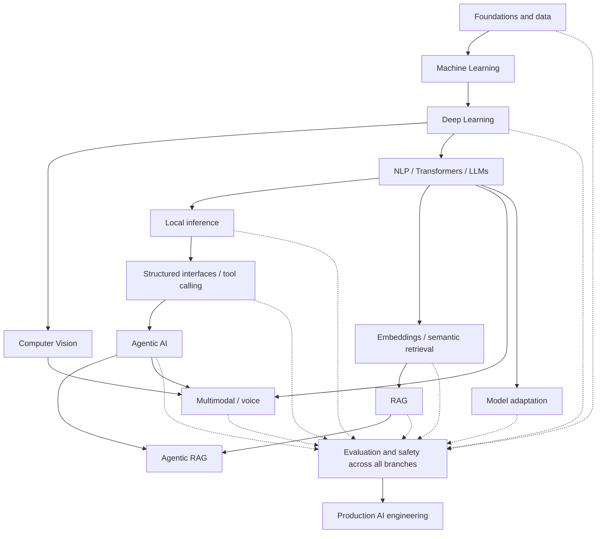

# AI Engineering Lab

A hands-on AI Engineering laboratory focused on understanding modern AI systems through implementation, experiments, evaluation and engineering analysis.

This repository is both:

- a structured technical learning notebook,
- and an engineering portfolio showing what has actually been implemented, executed and understood.

The objective is not to collect disconnected tutorials or simply call existing AI APIs.

The objective is to understand how AI systems work internally and how their components connect:

## AI Engineering Universe

This compact map shows major relationships; it is not a checklist of fields to master in sequence. Evaluation, safety and data quality apply across all branches.



[See the detailed AI Engineering Map](docs/ai-engineering-map.md).

**The map describes the territory: what exists and how concepts relate. [ROADMAP.md](ROADMAP.md) describes our selected route: the order in which concepts will be learned.** Tools and frameworks support the concepts; they do not replace them.

The learning process follows:

```text
CONCEPT
↓
QUESTION
↓
HYPOTHESIS
↓
IMPLEMENTATION
↓
EXPERIMENT
↓
EVIDENCE
↓
INTERPRETATION
↓
LIMITATIONS
↓
PRODUCT CONNECTION
```

Experiments are deliberately small so that individual mechanisms remain visible.

The existence of an experiment does not imply mastery of an entire field or production readiness.

**Lab scope:** theory, concept explanations, small focused exercises and small controlled experiments that explain mechanisms from first principles. This includes small retrieval, RAG, MCP, memory, coding-agent, workflow, voice and multimodal exercises when they answer a clear learning question.

Larger systems combining many learned concepts belong in independent repositories. This lab does not plan or catalog those repositories. Learn the underlying concepts here first through bounded experiments.

---

## Repository Structure

```text
AiEngineeringLab/
│
├── docs/
│   ├── ai-engineering-map.md
│   ├── ecosystem-map.md
│   ├── glossary.md
│   ├── learning-method.md
│   ├── model-runtime-application.md
│   └── verification.md
│
├── tools/
│   └── hardware_report.py
│
├── topics/
│   ├── 01_machine_learning/
│   ├── 02_deep_learning/
│   ├── 03_computer_vision/
│   └── 04_llm_engineering/
│
├── .gitignore
├── README.md
├── requirements.txt
└── ROADMAP.md
```

### `topics/`

Small experiments used to understand individual concepts and mechanisms.

Examples:

```text
decision trees
overfitting
neural networks
CNNs
tokenization
embeddings
self-attention
causal attention
```

### `docs/`

Cross-topic documentation explaining concepts that span multiple experiments. Start with the [AI Engineering Map](docs/ai-engineering-map.md), [learning method](docs/learning-method.md) and [glossary](docs/glossary.md).

### `tools/`

Reusable engineering utilities supporting the laboratory.

### `ROADMAP.md`

The main learning path, current progress and planned future work.

**Professional direction: AI Automation & Agentic Systems Engineering.** The lab pursues it through two complementary tracks that never replace each other: **Core AI Engineering** (understand how AI systems work: ML, DL, Transformers, LLMs, embeddings, RAG, evaluation, adaptation) and **Applied AI Automation & Agentic Systems** (solve real business problems with process analysis, APIs, webhooks, n8n, structured outputs, tool calling, agents, MCP, LangChain / LangGraph and human approval). Agents are never the default answer; frameworks come after the primitives they implement. See the [ROADMAP](ROADMAP.md), the [AI Engineering map](docs/ai-engineering-map.md) and the [Learning Cockpit](tools/learning_cockpit/README.md).

The roadmap describes progression.

It is not the repository directory structure.

---

## Current Progress

| Domain | Status |
|---|---|
| Machine Learning Foundations | Complete |
| Deep Learning Foundations | Complete |
| Computer Vision Foundations | Complete |
| LLM Fundamentals | In progress |
| Local Model Inference (Phase 05) | Planned |
| LLM Application Interfaces (Phase 06) | Planned |
| AI Automation Foundations (Phase 07) | Planned |
| Embeddings and Semantic Retrieval (Phase 08) | Planned |
| RAG and Knowledge Systems (Phase 09) | Planned |
| Agentic Systems Fundamentals (Phase 10) | Planned |
| MCP and Integration (Phase 11) | Planned |
| Agent Frameworks and Orchestration (Phase 12) | Planned |
| Multimodal AI, Fine-Tuning, AI Backend, Production AI (Phases 13–17) | Planned |

---

## Current Learning Position

**Phase 04 is IN PROGRESS. Experiment 29 — Language-Model Training Loop is COMPLETE; Experiment 30 — Autoregressive Generation and Sampling remains NEXT.** The [last completed experiment](topics/04_llm_engineering/17_training_loop/README.md) documents optimization and memorization of a tiny sequence, not general language understanding.

The current main path is:

```text
AI Engineering
│
├── Machine Learning ✅
├── Deep Learning ✅
├── Computer Vision Foundations ✅
│
└── LLM Engineering ← CURRENT
    │
    ├── Tokenization ✅
    ├── Token IDs ✅
    ├── Token Embeddings ✅
    ├── Positional Embeddings ✅
    ├── Self-Attention ✅
    ├── Causal Self-Attention ✅
    ├── Multi-Head Attention ✅
    ├── Attention Output Projection ✅
    ├── Residual Connection ✅
    ├── Layer Normalization ✅
    ├── Feed-Forward Network ✅
    ├── Complete Transformer Block ✅
    ├── Stacked Transformer Blocks ✅
    ├── Language-Model Head + Vocabulary Logits ✅
    ├── Softmax + Next-Token Probabilities ✅
    ├── Shifted Targets + CrossEntropyLoss ✅
    ├── Backpropagation + Gradients ✅
    ├── Optimizer Update ✅
    ├── Training Loop ✅
    └── Autoregressive Generation + Sampling ← NEXT
```

The current objective is to understand the internal mechanics of a GPT-like language model before moving into higher-level LLM applications.

The progression is:

```text
text
↓
tokenization
↓
token IDs
↓
embeddings
↓
positional information
↓
causal self-attention
↓
multi-head attention
↓
Transformer block
↓
Transformer stack
↓
language-model head
↓
vocabulary logits
↓
next-token prediction
↓
training
↓
sampling
↓
generation
```

The eventual result of this phase will be a small educational GPT-like model implemented from first principles using PyTorch.

---

## Completed Foundations

### Machine Learning

Implemented experiments covering:

- supervised learning,
- decision trees,
- train/test separation,
- model capacity,
- overfitting,
- generalization,
- evaluation limitations.

The experiments demonstrated that stronger training performance does not necessarily imply better generalization.

---

### Deep Learning

Implemented PyTorch experiments covering:

- tensors,
- linear layers,
- activations,
- logits,
- binary classification,
- loss functions,
- backpropagation,
- optimizers,
- normalization,
- classification thresholds,
- precision,
- recall,
- F1,
- confusion matrices.

The training loop was studied explicitly:

```text
forward pass
↓
prediction
↓
loss
↓
backpropagation
↓
gradients
↓
optimizer
↓
updated parameters
```

---

### Computer Vision

Implemented experiments covering:

- convolution,
- manually defined filters,
- multiple feature maps,
- learned convolution filters,
- pooling,
- CNN architectures,
- synthetic image classification,
- PyTorch DataLoaders,
- mini-batches,
- MNIST,
- multiclass classification,
- error analysis,
- confusion matrices,
- per-class evaluation.

A multiclass CNN achieved approximately:

```text
98%+ held-out MNIST test accuracy
```

The focus was not the score itself, but understanding the complete training and evaluation pipeline.

---

## LLM Engineering Experiments

Current experiments live under:

```text
topics/04_llm_engineering/
```

Implemented so far:

```text
01_tokenization
02_embeddings
03_positional_embeddings
04_self_attention
05_causal_attention
06_multi_head_attention
07_attention_output_residual
08_layer_normalization
09_feed_forward_network
10_transformer_block
11_stacked_transformer_blocks
12_lm_head_logits
13_softmax_probabilities
14_shifted_targets_cross_entropy
15_backpropagation_gradients
16_optimizer_update
17_training_loop
```

These experiments progressively build the internal representation pipeline of an autoregressive Transformer.

The next experiment is **Experiment 30 — Autoregressive Generation and Sampling (NEXT)**. It has no completed result or implementation directory yet. See the [LLM topic map and progress](topics/04_llm_engineering/README.md).

---

## AI Ecosystem Map

The [detailed AI Engineering Map](docs/ai-engineering-map.md) adds a hierarchy, progress markers and a technology index. The existing [ecosystem overview](docs/ecosystem-map.md) provides complementary relationships.

It distinguishes between:

- foundations,
- machine learning,
- deep learning,
- AI domains,
- LLM engineering,
- AI applications,
- infrastructure,
- production engineering,
- specialized branches.

---

## Model, Runtime and Application

A model is not an application and model weights do not execute themselves.

The relationship between:

```text
application
runtime
model
compute
hardware
```

is documented separately in:

```text
docs/model-runtime-application.md
```

---

## Learning Principles

The repository follows several rules.

### Understand before abstracting

Understand the primitive → build a minimal version → understand its limitations → then learn the framework. Start with visible mechanisms before relying on frameworks that hide them.

For example:

```text
manual convolution
↓
PyTorch Conv2d
```

and:

```text
manual self-attention
↓
Transformer abstractions
```

### Change one variable at a time

Experiments should isolate a specific question whenever possible.

### Separate evidence from assumptions

A result is only evidence for the conditions actually tested.

### Understand tensor shapes

Tensor shapes should always have a physical or conceptual interpretation.

### Evaluate, do not only train

Training metrics alone do not demonstrate useful generalization.

### Prefer transferable concepts

Frameworks change.

Core ideas such as:

```text
embeddings
attention
retrieval
evaluation
inference
latency
memory
tool boundaries
```

are more durable.

---

## ZERO EXTRA COST

Prefer open-source software, local models, local execution and free official datasets/resources. No paid API, credits, hosted inference or paid SaaS is required. Keep exercises within available hardware and document resource limits.

## Setup

Create a virtual environment:

```bash
python -m venv .venv
```

Activate on Windows PowerShell:

```powershell
.\.venv\Scripts\Activate.ps1
```

Activate on Linux or macOS:

```bash
source .venv/bin/activate
```

Install dependencies:

```bash
python -m pip install -r requirements.txt
```

Experiments should normally be executed from the repository root.

Example:

```bash
python topics/04_llm_engineering/05_causal_attention/main.py
```

Reusable hardware inspection:

```bash
python tools/hardware_report.py
```

Downloaded datasets are stored under ignored local directories such as:

```text
data/
```

Large model artifacts and generated caches should not be committed to Git.

---

## Verification

Individual experiment READMEs retain their results and limitations. The dated [verification log](docs/verification.md) records earlier checks; it is not a complete list of subsequent experiments. This documentation correction adds no new execution result.

Fixed random seeds improve reproducibility but do not guarantee identical results across:

- operating systems,
- hardware,
- library versions,
- numerical backends.

---

## Roadmap

The complete progression is documented in [ROADMAP.md](ROADMAP.md), with a [route guide after Phase 04](ROADMAP.md#route-after-phase-04):

```text
Phases 01–05  ML → DL → CV → LLM internals → local models & inference
Phase 06      LLM application interfaces (structured outputs, first tool call)
Phase 07      AI automation foundations   ┐ Applied track: 07 → 10 → 11 → 12
Phase 08–09   Embeddings → RAG            ┘ Core track:    08 → 09
Phase 10–12   Agent fundamentals → MCP → frameworks & orchestration
Phase 13–17   Multimodal → adaptation → AI backend → offline packaging → production AI
```

A future **Minimal Coding-Agent Experiment** will study controlled iterative tool use in a tiny deliberately broken toy workspace. It remains a small lab exercise, not a planned external repository. Hardware, benchmarking, evaluation, safety and software engineering are parallel tracks.

The roadmap intentionally separates:

```text
core learning path
```

from:

```text
parallel skills and future specializations
```

Not every AI technology requires the same depth of study.

---

## License

No open-source license is provided for this repository.

The source code and documentation are published as part of a personal technical learning and engineering portfolio.
