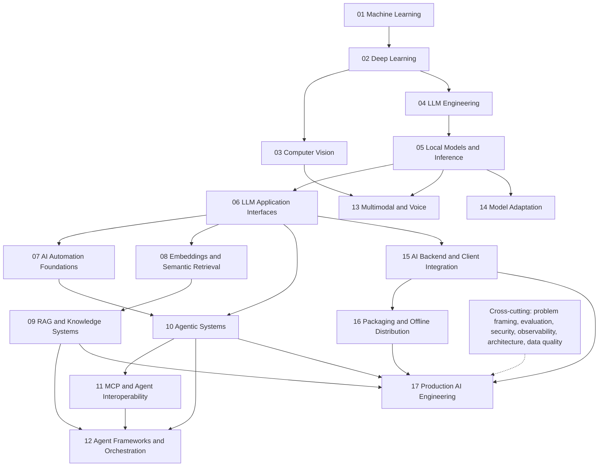
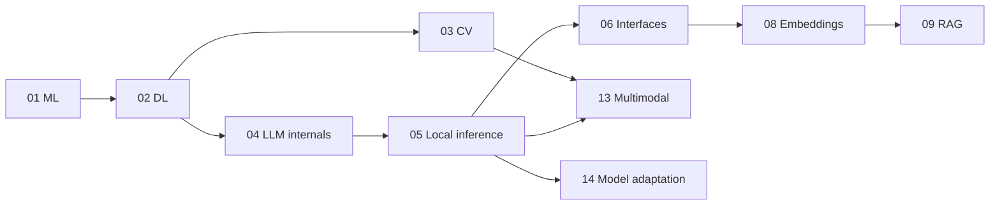
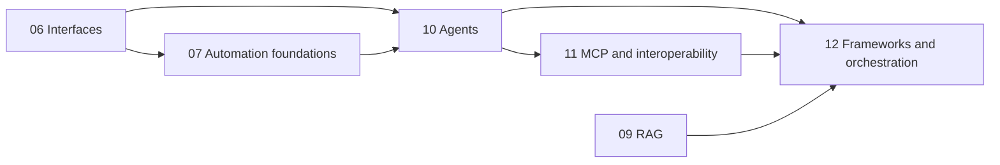
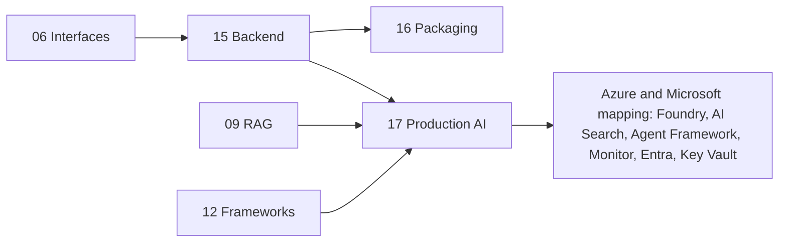

# AI Engineering Map

This is a **map of the field**, not a requirement to master every branch before building useful systems. Select the concepts needed for a question, build a small experiment, and evaluate the result.

**The map describes what exists. [ROADMAP.md](../ROADMAP.md) describes the order selected for this learning journey.** Topic directories organize technical domains; they do not need to mirror either document.

## Status and Current Position

| Marker | Meaning in this map |
|---|---|
| ✅ Studied | Specific concepts with completed experiments documented in this repository; not mastery of a field |
| 🟡 In progress | A learning phase with work underway and remaining concepts |
| ⬜ Planned | Future study, with no completion claim |
| 🔹 Advanced / later | Awareness or deeper study beyond the immediate route; not a completion claim |

The foundation phases in ML, DL and CV are recorded as complete. **Phase 04 — Transformer and LLM Fundamentals is in progress.** Experiments 13–29 cover tokenization through the training loop. [Experiment 29](../topics/04_llm_engineering/17_training_loop/README.md) records a loss reduction from `2.8116908073425293` to `0.011777641251683235` on the tiny training sequence; this demonstrates optimization and memorization, not general language understanding.

**Next: Experiment 30 — Autoregressive Generation and Sampling.** It remains `NEXT` in the roadmap; no experiment directory or completed result exists for it yet. Current progress comes from the [topic overviews](../README.md#current-progress) and individual experiment notes, not from the presence of a term in this map. The dated [verification log](verification.md) is historical and is not a complete index of subsequent learning.

## Two Complementary Tracks

The professional direction is **AI Automation & Agentic Systems Engineering**. The map has two tracks that converge in production systems; neither replaces the other.

```text
                              AI ENGINEERING
                                    │
          ┌─────────────────────────┴─────────────────────────┐
          │                                                   │
   CORE AI ENGINEERING                              APPLIED AI SYSTEMS
   (how AI works)                          (how AI solves business problems)
          │                                                   │
 ML / DL / CV / Transformers                        Process analysis
          │                                          Automation foundations
   Local models & inference                       APIs · webhooks · n8n
          │                                                   │
 Structured outputs ◄─────── bridge ───────────────► Integrations
          │                                                   │
 Embeddings / retrieval                             Tool calling
          │                                                   │
          ├────────────────────► RAG ◄────────────────────────┤
          │                                                   │
 Evaluation ◄──────────── cross-cutting ─────────────► Agent loops · state
          │                                                   │
 Multimodal · model adaptation                        MCP
          │                                                   │
          │                                   LangChain · LangGraph · orchestration
          │                                                   │
          └─────────────────────────┬─────────────────────────┘
                                    │
                         PRODUCTION AI SYSTEMS
              (reliability · security · observability · cost)
```

| Track | Contains | Roadmap phases |
|---|---|---|
| **Core AI Engineering** | ML, DL, CV, Transformer internals, LLM generation, embeddings and retrieval, multimodal, model adaptation | 01–04, 08, 13–14 |
| **Applied AI Automation & Agentic Systems** | process analysis, automation foundations, agent loops, MCP, frameworks, orchestration | 07, 10–12 |
| **Bridge** | local models, LLM interfaces (structured outputs, tool calling), RAG, backend and production engineering | 05, 06, 09, 15–17 |
| **Cross-cutting** | problem framing, evaluation, security, privacy, reliability, observability, cost | every phase |

In the Learning Cockpit each lane shows its track, and every node carries one. Phase numbers are sequential; the tracks run in parallel conceptually.

## Global Map: the 17 Phases

The same structure the Learning Cockpit draws as its Overview. Phase numbers are the study order in [ROADMAP.md](../ROADMAP.md); arrows are the prerequisite relationships between phases derived from the concept graph (transitive edges omitted), not a checklist. Concept-level detail lives in each phase README and in the Cockpit's Detailed map.



### Core track (how AI works)



### Applied track (how AI solves business processes)



### Enterprise and production (convergence)



| Phase | Domain | Track | Overview |
|---|---|---|---|
| 01–03 | ML, Deep Learning, Computer Vision | Core | [01](../topics/01_machine_learning/README.md) · [02](../topics/02_deep_learning/README.md) · [03](../topics/03_computer_vision/README.md) |
| 04 | LLM Engineering | Core | [04](../topics/04_llm_engineering/README.md) |
| 05 · 06 | Local models · LLM interfaces | Bridge | [05](../topics/05_local_models_inference/README.md) · [06](../topics/06_llm_application_interfaces/README.md) |
| 07 | AI Automation Foundations | Applied | [07](../topics/07_ai_automation_foundations/README.md) |
| 08 · 09 | Embeddings and retrieval · RAG | Core · Bridge | [08](../topics/08_embeddings_semantic_retrieval/README.md) · [09](../topics/09_rag_knowledge_systems/README.md) |
| 10–12 | Agents · MCP and interoperability · Frameworks | Applied | [10](../topics/10_agentic_systems/README.md) · [11](../topics/11_mcp_integration/README.md) · [12](../topics/12_agent_frameworks_orchestration/README.md) |
| 13 · 14 | Multimodal / voice · Model adaptation | Core | [13](../topics/13_multimodal_voice/README.md) · [14](../topics/14_model_adaptation/README.md) |
| 15–17 | Backend · Packaging · Production AI | Bridge | [15](../topics/15_ai_backend_client_integration/README.md) · [16](../topics/16_packaging_offline_distribution/README.md) · [17](../topics/17_production_ai_engineering/README.md) |

**One document, one responsibility:** README (orientation) · ROADMAP (the single ordered route) · this map (the territory) · [learning method](learning-method.md) · [professional capabilities](professional-capabilities.md) · topic README (one phase) · experiment README (theory, hypothesis, implementation, results) · `catalog.json` (machine-readable curriculum, derived views) · SQLite (personal progress).

## How the Branches Connect

```text
Foundations + data → ML → DL → CNNs / Transformers
                                  │          │
                                  CV       NLP / LLMs
                                              │
                           local inference → model interfaces
                                              │
                                      structured tools → agents

Retrieval embedding models → semantic search → RAG
                                               + agents → agentic RAG
Multimodal models + tools / agents → vision agents / voice systems

Across every branch: data quality, evaluation, safety and software engineering
Across increasing system scope: production engineering concepts
```

These are useful dependencies and overlaps, not a strict taxonomy. Retrieval does not require generation; agents do not require RAG; Transformers are also used outside language models. The [model/runtime/application guide](model-runtime-application.md) explains the execution stack, a different view of the same systems.

## Foundations

Prerequisites support AI-specific experiments; they are not all separate AI topics to complete first.

- **Software foundations:** Python, software engineering, Git, Linux, testing, data structures and algorithms.
- **Mathematical foundations:** linear algebra, probability, statistics, calculus / gradients and numerical computing.
- **Current evidence:** Python, NumPy, PyTorch tensor operations and gradients appear in existing experiments. Their use does not establish completion of a full mathematics, Linux, algorithms or software-engineering curriculum.
- **⬜ Further study:** strengthen these prerequisites alongside the main route as an experiment requires them.

## Machine Learning

Learning patterns from data connects inputs, objectives and evaluation.

- ✅ **Studied in [ML experiments](../topics/01_machine_learning/README.md):** supervised classification, features, labels, decision trees, train/test separation, model capacity, overfitting, underfitting, accuracy and generalization limits.
- ✅ **Shared with [DL experiments](../topics/02_deep_learning/README.md):** loss functions, gradient descent / optimization, precision, recall, F1 and decision thresholds.
- ⬜ **Broader field:** unsupervised learning, regression, additional classical ML models, feature engineering, validation sets, cross-validation, regularization and more systematic evaluation.
- **Implementation tool:** scikit-learn. Understanding a model and its evaluation is distinct from knowing this library's interface.

## Deep Learning

Trainable layers build representations; an objective and optimizer determine how parameters change.

- ✅ **Studied in [DL experiments](../topics/02_deep_learning/README.md):** tensors, neural networks, forward pass, activation functions, loss, backpropagation, gradients, optimizers, normalization and training loops using PyTorch.
- ✅ **Studied across [CV](../topics/03_computer_vision/README.md) and [LLM](../topics/04_llm_engineering/README.md):** mini-batches, CNNs and small causal Transformer components through a training loop.
- ⬜ **Extensions:** systematic regularization, learning-rate schedules, other sequence models and larger-data training.
- **Framework:** PyTorch implements tensor operations and automatic differentiation; those mechanisms remain the subject of study.

## Computer Vision

Images have spatial structure; representations support tasks beyond a single class prediction.

- ✅ **Studied in [CV foundations](../topics/03_computer_vision/README.md):** images as tensors, convolutions, filters, feature maps, pooling, CNNs, synthetic image classification, MNIST datasets, DataLoaders, mini-batches, multiclass classification and error analysis.
- **Evidence:** the topic documents `98.08%` test accuracy for the MNIST CNN and `98.55%` in the separate error-analysis run. These are task-specific observations, not evidence of general visual robustness.
- ⬜ **Future:** augmentation, transfer learning, object detection, segmentation, vision transformers and multimodal vision-language models.
- **Tools already used:** PyTorch, torchvision and matplotlib. New architectures should answer a concrete learning question.

## NLP and LLM Fundamentals

NLP includes many language tasks; autoregressive language modelling is the current focus, not the whole field.

```text
✅ Character tokenization / vocabulary / token IDs
   → ✅ Token embeddings + positional information
   → ✅ Attention: Q / K / V, causal masking, multi-head attention
   → ✅ Output projection + residual connections + LayerNorm + FFN
   → ✅ Transformer blocks → stacked Transformers
   → ✅ LM Head → logits → Softmax → next-token probabilities
   → ✅ Shifted targets + CrossEntropyLoss
   → ✅ Backpropagation + gradients + optimization + training loops
   → ⬜ Autoregressive generation + sampling [Experiment 30: NEXT]
   → ⬜ Context-window handling and broader inference study
```

**🟡 Phase 04 remains in progress.** Existing [LLM experiments](../topics/04_llm_engineering/README.md) use a tiny educational model. Character-level vocabulary construction is studied; broader text preprocessing and production tokenizer behavior remain future work. Greedy selection of predictions in a training example is not yet a completed autoregressive generation workflow.

Further study includes temperature, top-k / top-p sampling and context windows. Architectural extensions such as RoPE, KV cache and grouped-query attention are later work. Training on `hello` does not establish language understanding.

## Local Models and Inference

⬜ **Planned practical study.** Existing PyTorch forward passes introduce inference, and the hardware utility is a diagnostic; neither completes a local pretrained-model runtime study.

- **Execution:** model inference, model loading, CPU vs GPU, RAM / VRAM, context length and hardware-aware model selection.
- **Artifacts and runtimes:** Ollama, llama.cpp, GGUF and quantization. GGUF is a file format; Ollama and llama.cpp are software used to run compatible models.
- **Behavior to measure:** tokens per second, latency, throughput, streaming, local APIs and benchmarking.
- **Evidence to collect:** model and artifact identity, hardware, runtime settings, prompt, context and repeated measurements, with quality checks.

## Model Interfaces and Structured LLM Applications

⬜ **Planned; before full agentic systems.** These primitives connect Python ↔ LLM behavior without delegating all control to a model.

- **Conversation and input:** chat messages, system / user / assistant roles and prompt construction.
- **Output contracts:** structured outputs, JSON Schema, parsing and application-side validation.
- **Actions:** function calling / tool calling, argument validation, authorization, execution and returning results.
- **Reliability:** streaming, error handling, timeouts and bounded retries.
- **Optional implementation tools to learn:** Pydantic for data validation and FastAPI for a local service interface. A schema does not by itself authorize an action or prove semantic correctness.

## AI Automation Foundations

⬜ **Planned; begins the applied track (Phase 07).** Solving a real business problem starts before any model: understand the process, then decide what AI adds.

```text
Process discovery → map the current workflow
  → deterministic steps  |  uncertain / semantic steps
  → is AI actually appropriate?  → choose the simplest architecture
  → structured inputs / outputs → integrate APIs and data
  → failures, retries, timeouts → human approval where necessary
  → evaluate against a baseline → observe and monitor
```

- **Fundamentals:** business-process decomposition, deterministic workflows, rules versus AI, HTTP, REST APIs, JSON, webhooks, authentication concepts, data transformation and validation, retries, timeouts, idempotency, error handling, human approval, auditability and workflow evaluation.
- **Architecture choice:** deterministic code, workflow automation, a single LLM call, RAG, an agent and a multi-agent system solve different problems. An agent is never the default answer; prefer the simplest design that works.
- **n8n:** a workflow platform, learned locally (self-hosted) after the fundamentals; n8n Cloud and paid tiers are not required.
- **Small future experiments:** deterministic triage, webhook → validation → routing, API → transform → output, retry / error handling, human approval, a simple local n8n workflow. A passing score on original cases is a baseline, not proof of generalization.

## Cross-cutting Architecture Skills

Required to build systems a company could trust, applied in every phase: requirements and problem framing, process mapping, API integration, data schemas, validation, reliability, error handling, retries, idempotency, human-in-the-loop, evaluation, observability, privacy, security, cost awareness, build-versus-buy reasoning and local-versus-hosted architecture. Each applied experiment asks: what is the baseline, what is success, which failures exist, how is generalization tested, is AI better than deterministic logic, what happens when the model fails, and when must a human intervene?

## Embeddings and Retrieval

**Two meanings must stay separate:**

| Representation | Purpose | Current status |
|---|---|---|
| Internal token embeddings inside Transformers | Map token IDs to trainable vectors used by the language model | ✅ Studied in the token-embedding experiment |
| Embedding models used for semantic retrieval | Encode queries and documents into vectors suitable for similarity-based retrieval | ⬜ Planned; not demonstrated by a token-table lookup |

Future retrieval study includes embedding models, vector representations, similarity, cosine similarity, semantic search, nearest-neighbor search, vector indexes, chunking, metadata, reranking and retrieval evaluation.

**Technology choices to learn, not mandatory dependencies:** begin with small in-memory / NumPy comparisons; later consider FAISS, SQLite-based approaches or other local vector indexes when persistence, size or search requirements justify them. No paid vector service is required.

## RAG

⬜ **Planned.** Retrieval-augmented generation supplies external evidence to generation; retrieving a document does not guarantee that the answer uses it correctly.

```text
Document ingestion → parsing → chunking + metadata → embeddings → indexing
Query → retrieval → reranking → prompt/context construction
      → grounded generation → citations / abstention → evaluation
```

Later comparisons can cover hybrid retrieval, query rewriting and RAG failure modes: missing evidence, poor chunks, irrelevant retrieval, stale documents, unsupported claims and misleading citations. Evaluate retrieval and answers separately. A small end-to-end RAG exercise belongs in this lab when its purpose is to understand ingestion, retrieval and grounding, with controlled data and a bounded scope.

## Agentic AI

⬜ **Planned major branch.** An agent uses a control loop around a model, with explicit state, permitted actions and stopping conditions. A deterministic workflow can be preferable when its steps are known.

```text
Structured outputs → function calling / tool calling
  → validated tool execution
  → agent loop from scratch + state + observations + termination
  → short-term memory / long-term memory + context engineering
  → planning + reflection / retry loops + error recovery
  → permissions + sandboxing + human-in-the-loop approvals
  → agent evaluation
  → protocol / framework comparisons
  → subagents + multi-agent systems + orchestration
  → coding agents / research agents / persistent agents
```

Permissions, evaluation and budgets apply from the first executable loop, not only after planning or memory is added. Reflection is another model step to evaluate; it is not evidence that an answer improved. Persistent agents also need state lifetime, recovery and resource limits.

### Primitives Before Protocols and Frameworks

| Foundation to understand first | Later technology to learn | Role |
|---|---|---|
| Tool schemas, client/server boundaries and authorization | MCP | Protocol for connecting tools and context; not an agent loop or permission policy by itself |
| Minimal agent loop, tool execution and state | LangChain / LangGraph | Frameworks for application composition and stateful workflow / agent orchestration |
| Triggers, deterministic steps, retries and human approval | n8n | Workflow automation platform; learning the tool does not replace workflow fundamentals |

**Understand the primitive → build a minimal version → understand its limitations → then learn the framework.** These names identify future learning options, not installed dependencies or completed work. Small controlled MCP, LangChain, LangGraph and n8n exercises can belong in the lab after their underlying concepts. Use free local configurations within the cost policy; a framework is optional.

### Minimal Coding-Agent Experiment

⬜ **Planned small educational lab experiment.** A local model would receive only a small controlled tool set such as `read_file(path)`, `write_file(path, content)` and `run_tests()`. Given a tiny deliberately broken toy workspace and a failing test, it would request a tool, receive the host program's result, choose the next action, and repeat within a strict budget.

```text
Failing test → local LLM → structured tool request
    → Python host validates permission and executes the tool
    → tool result returned to the model → conversation / state updated
    → next tool or action → repeat until completion or a stop condition
```

Study how calls are represented, how Python executes them, how results return to the model, how state is maintained, and how termination, retries, permissions and sandboxing work. Evaluate task success, budget termination and denied actions. The purpose is to understand iterative tool use, not to build a general coding system. No code or placeholder directory is added now.

## Multimodal AI

⬜ **Planned beyond the existing CV foundations.** Study vision-language models, image understanding, image generation, audio, speech-to-text, text-to-speech, multimodal prompting and video concepts. Representation, input processing and evaluation differ by modality; completing a CNN exercise does not complete this branch.

Small multimodal prompting, input/output and evaluation exercises fit the lab. Connect only enough components to answer a clear concept question.

## Voice AI

⬜ **Planned; overlaps multimodal and agentic AI.** A voice system can combine speech recognition → LLM reasoning / response generation → text-to-speech. Small controlled voice experiments can study streaming, latency, turn detection and interruption handling before adding actions through a voice agent. A voice interface does not inherently require an agent loop.

## Model Adaptation

⬜ **Planned.** Fine-tuning, instruction tuning, LoRA, QLoRA, PEFT, datasets, training data quality, evaluation and model merging concepts belong here. Compare adaptation against an unchanged baseline and distinguish changing parameters from providing retrieved context. Scale work to available local memory and compute; no paid training service is required.

## Reinforcement Learning

🔹 **Later awareness, not an immediate priority.** Reinforcement learning fundamentals include reward, policy, value and exploration. RLHF concepts connect feedback to model training; preference optimization concepts concern learning from comparisons and need not all use the same RL procedure. This branch can wait until its prerequisites or a concrete learning question justify it.

## AI Evaluation

**Cross-cutting from the first experiment.** ✅ Classification metrics, held-out tests, error analysis, manual numerical checks and tiny-sequence training checks already appear in this lab. They establish scoped evidence, not a comprehensive evaluation system.

⬜ Extend to offline evaluation, task-specific metrics, golden datasets, human evaluation, RAG evaluation, agent evaluation, regression tests and inference benchmarking. Study LLM-as-judge limitations, including sensitivity to prompts, ordering and shared model biases; a judge score is not ground truth. Evaluate quality alongside time, memory and failure behavior.

## Safety and Security

⬜ **Planned explicit study, applied when relevant from the start.** Cover prompt injection, tool permissions, sandboxing, secret handling, untrusted input, data privacy, model output validation, RAG poisoning concepts and agent safety. Retrieved text, model output and tool results should not acquire authority merely because they appear in context. Permission checks belong in application code, with tests for denied actions.

## AI Data Engineering

✅ Existing experiments introduce synthetic data generation, labels, normalization and train/test splits; MNIST adds dataset access and batching. This is not completion of a data-engineering curriculum.

⬜ Broader study includes dataset collection, cleaning, labeling, data quality, validation splits, pipelines, synthetic data concepts and document processing. Data provenance, leakage and representativeness affect training, retrieval and evaluation alike.

## MLOps / LLMOps / Production AI

⬜ **Planned dedicated study.** Experiment tracking, model versioning, evaluation pipelines, observability, logging, monitoring, caching, queues, async execution, service APIs, containers, deployment, local/offline packaging, CI, testing, performance and cost awareness support reliable systems.

FastAPI is one possible service framework; Docker is one possible container tool. First understand API contracts, process boundaries and reproducibility. Small service, packaging and operations exercises belong here when they explain one mechanism or a controlled workflow.

## Advanced / Later Topics

🔹 **Awareness only; not the next checkpoint:** distributed training, GPU optimization, CUDA concepts, mixed precision, KV cache, FlashAttention concepts, Mixture of Experts, distillation, speculative decoding and serving systems. Some terms appear in existing future notes; appearance is not evidence of a completed experiment.

Other existing specialization routes remain in the [roadmap](../ROADMAP.md#specialization-tracks): time series, Edge AI, robotics, Graph AI, digital twins and scientific ML. Choose depth according to a concrete question and available resources.

## Technology Index

Names below are grouped by purpose. **Fundamentals first, framework second.** Existing use is stated explicitly; planned options are not required dependencies or a checklist of tools to collect.

| Purpose | Technologies / interfaces | Place in this lab |
|---|---|---|
| Core ML / DL | Python, NumPy, pandas, scikit-learn, PyTorch | Used by existing experiments; focus on data, models and optimization |
| Computer vision | torchvision, matplotlib | Used for datasets and inspection alongside PyTorch |
| Local inference | Ollama, llama.cpp; GGUF as an artifact format | Planned; learn loading and inference before comparing runtimes |
| LLM applications | Python interfaces, JSON Schema, Pydantic, FastAPI | Planned; structured outputs and tool calling are interface patterns, not frameworks |
| Retrieval | Retrieval embedding models, FAISS, SQLite-based approaches, other local vector indexes | Planned; understand vectors and ranking before an index library |
| Agents and workflows | MCP, LangChain, LangGraph, n8n | Planned; protocol / frameworks / automation platform with different roles, following primitive implementations |
| Automation foundations | HTTP, REST, webhooks, JSON, n8n (self-hosted) | Planned (Phase 07); workflow fundamentals before the platform |
| Model adaptation | PyTorch, PEFT | Planned adaptation study; training and evaluation principles precede adapter tooling |
| Engineering | Git, pytest, Docker concepts, CI, logging / observability | Git is used; dedicated testing, container and operations studies remain planned |

Planned additions (all `PLANNED`, tiered as hands-on / compare / awareness / enterprise-mapping in [Professional capabilities and technology tiers](professional-capabilities.md)): vLLM and LiteLLM (serving, gateways); DSPy; BM25, pgvector, Qdrant and Azure AI Search (retrieval); LlamaIndex; A2A and AG-UI (interoperability); Microsoft Agent Framework, PydanticAI, OpenAI Agents SDK, CrewAI; Playwright; Redis, RabbitMQ, Kafka; Docker and Kubernetes; GitHub Actions and OpenTelemetry concepts.

## Complementary Learning Resources

Free external courses complement, and do not replace, the lab's experiments. They are registered once in the Learning Cockpit catalog and shown on the relevant concepts: the Hugging Face LLM Course (LLM tooling, tokenizers, adaptation), the Hugging Face Agents Course (after tool calling and a minimal loop), LangChain / LangGraph learning material (after the from-scratch version) and n8n Academy (local instance). See the [roadmap table](../ROADMAP.md#external-learning-resources).

## Scope and ZERO EXTRA COST

**AiEngineeringLab = theory + concept explanations + small focused exercises + small experiments that explain concepts from first principles.** A useful experiment can group related steps into one meaningful workflow; every line does not need its own directory.

The **ZERO EXTRA COST** path prefers open-source software, local models, local execution and free official datasets/resources. It requires no paid API, credits, hosted inference or paid SaaS. Choose software and model artifacts whose terms permit the intended local use; named tools are options, not purchases or guaranteed compatibility combinations. Scale experiments to existing hardware and document any resource limit.

Learn the underlying concepts in small controlled lab experiments first. Optional larger systems combining many learned concepts belong in independent repositories. This map describes knowledge and progress; it does not plan or catalog external repositories. A normal link can be considered if a real relevant repository exists later.

## Navigate the Lab

- [Root overview and current position](../README.md)
- [Ordered learning route](../ROADMAP.md)
- [ML](../topics/01_machine_learning/README.md), [DL](../topics/02_deep_learning/README.md), [CV](../topics/03_computer_vision/README.md), [LLM](../topics/04_llm_engineering/README.md) topic progress
- [Ecosystem Map (technologies and frameworks)](ecosystem-map.md) and [execution-stack boundaries](model-runtime-application.md)
- [Learning method](learning-method.md), [living glossary](glossary.md) and [historical verification log](verification.md)
